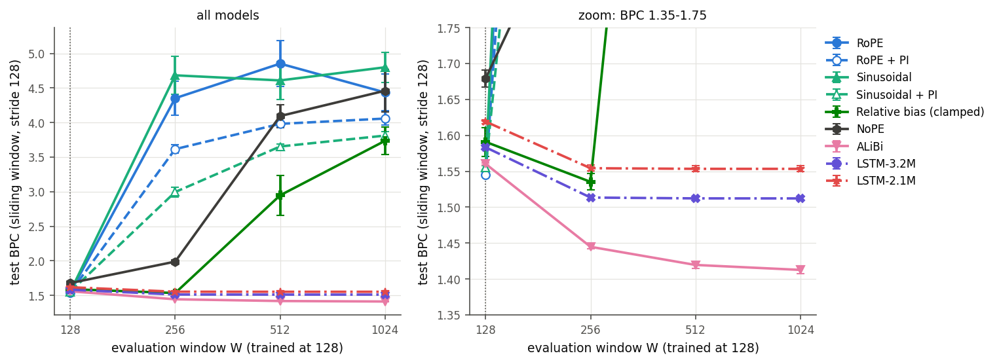

# Positional Encodings and Length Extrapolation in Small Character-Level Transformers

A controlled comparison of a 3.2M-parameter decoder-only Transformer and parameter-matched LSTMs for character-level
language modelling on text8, in JAX/Flax. Hyperparameters were chosen on validation data only, with decision rules fixed
in advance; every result is the mean ± std over 3 seeds, evaluated with full-context (sliding-window) scoring.
The Transformer (RoPE) reaches **1.453 test BPC**, 0.062 better than an LSTM with the same parameter count. Among seven
positional encodings, RoPE is best at the training length (128 characters), but only **ALiBi extrapolates**: it keeps
improving up to 1,024 characters (1.413 BPC), while RoPE, sinusoidal and NoPE break down beyond the training length and
position interpolation without fine-tuning does not rescue them. Attention statistics show why: past the training length,
RoPE and sinusoidal attention becomes diffuse, while ALiBi's stays local.

## Main results

Test set, best-validation-loss checkpoint, mean ± std over seeds 42–44 ([`results/v4/tables/table_v_tie.md`](results/v4/tables/table_v_tie.md)):

| Model | Parameters | lr | Test BPC | Accuracy (%) | s / training step |
|---|---|---|---|---|---|
| Transformer (RoPE) | 3,169,280 | 1.8e-3 | **1.4532 ± 0.0055** | 68.55 ± 0.11 | 0.0280 |
| LSTM-3.2M | 3,177,052 | 3.2e-3 | 1.5152 ± 0.0017 | 67.12 ± 0.02 | 0.0664 |
| LSTM-2.1M | 2,115,072 | 3.2e-3 | 1.5557 ± 0.0040 | 66.26 ± 0.08 | 0.0526 |

The ordering is unchanged at each family's lowest-BPC learning rate (Transformer 1.4412 ± 0.0003, LSTM-3.2M 1.4957 ± 0.0033;
[`table_v_bestlr.md`](results/v4/tables/table_v_bestlr.md)). Step times are from this JAX implementation on one RTX 3090; the LSTM is
a `jax.lax.scan` loop, not a fused cuDNN kernel.

Length extrapolation (all models trained on 128-character windows; sliding-window test BPC, stride 128;
[`extrapolation.md`](results/v4/tables/extrapolation.md)):



All findings, with numbers and caveats: [`results/v4/REPORT.md`](results/v4/REPORT.md). Every number of the write-up is traced to
a file in [`results/v4/claims.md`](results/v4/claims.md). The write-up itself (LaTeX) is maintained in a separate repository.

## Setup

```bash
conda env create -f environment.yml      # Python 3.10, JAX 0.6.2 (CUDA 12), Flax 0.10.7, Optax 0.2.8
conda activate charllm-env
python scripts/prepare_data.py           # downloads text8 (31 MB) -> data/text8_train.txt, data/text8_test.txt (md5-checked)
pytest                                   # 290 tests, CPU only, about 6 minutes
```

`data/text8_train.txt` is the first 90M characters of text8 (split 95/5 into training and validation by `train.py`);
`data/text8_test.txt` is the last 5M. If JAX reports "Unable to load cuSPARSE" and falls back to the CPU, a system CUDA in
`LD_LIBRARY_PATH` is shadowing the pip CUDA libraries: remove `/usr/local/cuda*` from it.

## Reproducing the results

Each command trains or evaluates one run; select the GPU with `CUDA_VISIBLE_DEVICES`. Outputs go to `runs/<run>/` and
`checkpoints/<run>/`. Times are for one RTX 3090. The launchers in `scripts/` queue all runs of a block
(`scripts/launch_v3.py`, `scripts/launch_v3_evals.py`, `scripts/launch_v4.py`, each with `--dry-run`).

| Report item | Command (per seed s ∈ {42, 43, 44}) | Time per run |
|---|---|---|
| Transformer vs LSTMs (tie-rule lr) | `python train.py --config configs/final/TR.yaml --seed s --run-name TR-final_s$s --set evaluation.full_context_batch_size=2048` (same for `LSTM.yaml` → `LSTM-final_s$s`, `LR-1.yaml` → `LR-1-final_s$s`) | 33 / 67 / 55 min |
| Transformer vs LSTMs (lowest-BPC lr) | as above with `--set training.learning_rate=2.7e-3` (Transformer) or `7.2e-3` (LSTMs), run names `..._bestlr` | same |
| Step times | `python train.py --config configs/final/TR.yaml --seed 42 --tuning --epochs 2000 --run-name timing_TR` (alone on the GPU) | 3 min |
| Positional encodings | `python train.py --config configs/final/TR.yaml --seed s --run-name TR-final-<pe>_s$s --set model.pos_encoding_type=<pe> --set evaluation.full_context_batch_size=2048`, `<pe>` ∈ learned, sinusoidal, hybrid, alibi, relative, none (run name `nope`) | 31 min |
| Dropout ablation | `TR.yaml` with `--set model.{emb,attn,resid,mlp}_dropout=0.1`, run names `TR-final-d0.1_s$s` | 33 min |
| Length extrapolation | `python scripts/eval_extrapolation.py --run <run> --lengths 128 256 512 1024 --sanity` | 4–7 min |
| Position interpolation | `python scripts/eval_extrapolation.py --run <run> --lengths 128 256 512 1024 --interpolate` (RoPE, sinusoidal runs) | 2 min |
| Attention analysis | `python scripts/analyze_attention.py --run <run>_s42 --length 128` (and `--length 512`, `--interpolate`) | < 1 min |
| Positional-encoding tables | `python scripts/export_pe_tables.py --run <run>_s42` | seconds |
| Hyperparameter search | `python scripts/launch_tuning.py` (rules: [`results/v3_tuning/REPORT.md`](results/v3_tuning/REPORT.md)) | 22 runs, 5–24 min each on an A100 (two at a time) |
| Learning-rate bracket check | `python train.py --config configs/final/TR.yaml --seed 4212 --tuning --set training.epochs=10000 --set training.learning_rate=<lr>` (and `LSTM.yaml`) | 7 / 12 min |
| All tables and figures | `python results/v4/aggregate_v4.py --sync` | 1 min |

`--tuning` never opens the test file: it scores the best-validation checkpoint on the validation split (`val_eval.json`).
[`results/README.md`](results/README.md) maps every table and figure to the file that produces it.

## Project layout

```
train.py                  training + evaluation entry point (data, model, loss, optimizer, schedule, evaluation)
transformer.ipynb         interactive alternative to train.py, built on the same functions
models/
  models.py               decoder-only Transformer; one attention module for every positional encoding
  positional_encodings.py sinusoidal, learned, hybrid, RoPE, ALiBi, relative bias (NoPE = no module)
  LSTM.py                 multi-layer LSTM (jax.lax.scan)
utils/                    evaluation (full-context, extrapolation, metrics, Self-BLEU), generation, checkpoints, plots
scripts/                  data preparation, launchers, extrapolation / attention / PE-table evaluation
configs/final/            the configurations used for every reported result
configs/*.yaml            legacy configurations of the original course project (pilot experiments), kept for history
tests/                    pytest suite (CPU)
results/                  committed results; v4/ is current (see results/README.md)
```

**Configs.** `configs/final/TR.yaml` (Transformer, RoPE; the other encodings via `--set model.pos_encoding_type=...`),
`configs/final/LSTM.yaml` (LSTM-3.2M, hidden 314) and `configs/final/LR-1.yaml` (LSTM-2.1M, hidden 256). All three: 4 layers,
128-character windows, batch 128, 50,000 iterations (`training.epochs` counts iterations), warmup 2,000 then cosine decay,
AdamW (weight decay 0.1 on matrices only), no dropout, no label smoothing. `--set section.key=value` overrides any key and is
recorded in the run's `config.yaml`.

**Evaluation-only options.** `scripts/eval_extrapolation.py` rebuilds a trained model for a longer window W: RoPE, ALiBi,
sinusoidal and NoPE need no change; relative bias clamps offsets beyond the trained table (T5-style); learned and hybrid
tables cannot be extended. `--interpolate` scales positions by 128/W (position interpolation, RoPE and sinusoidal only).

## Tests and code style

`pytest` runs on the CPU (`tests/conftest.py`). It covers causality and parameter counts for every encoding, bit-identity of the
encodings against saved reference logits, dropout RNG, the weight-decay mask, the LR schedule, the training loss, full-context
and extrapolation evaluation, attention capture and statistics, generation, Self-BLEU and the `--set` / `--tuning` options.

Style: Ruff (line length 140, rules E/W/F) on Python files and, via nbQA, on the notebook. CI runs
`pre-commit run --all-files`; run `ruff check .`, `nbqa ruff .` and `pre-commit run --all-files` locally before committing.

## Acknowledgments

Authors: Qiu Jinhang, Tian Junjie, Yu Hanyue, Liu Yuxin. text8 is from Matt Mahoney's
[compression benchmark](http://mattmahoney.net/dc/textdata.html). The original baseline notebook came from
[alexxthiery/char_transformer](https://github.com/alexxthiery/char_transformer).
